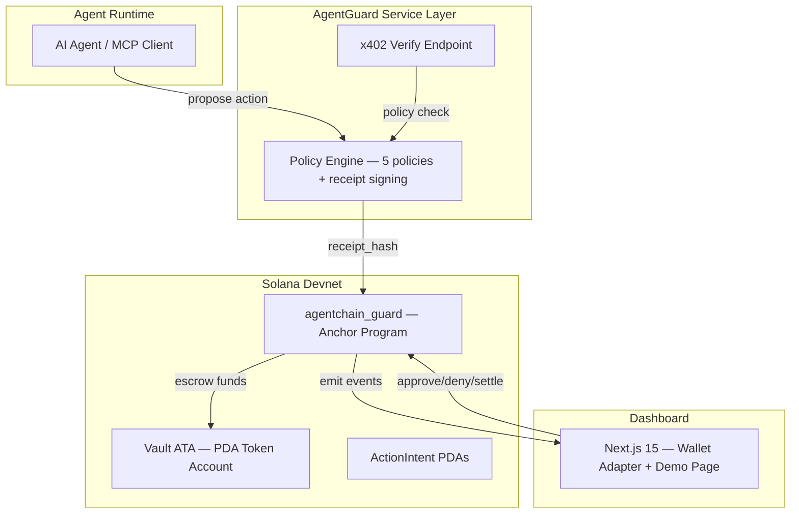

# 🛡️ AgentChain Guard for Solana

> **The policy and settlement control layer for autonomous commerce.**

[](LICENSE)
[](https://explorer.solana.com/address/HutGfrkJTsaGMC4bs7X2EFsbbP8LaTEDkWsEBM86RGHz?cluster=devnet)

Solana makes low-cost, high-frequency machine payments practical. But autonomous agents should not be allowed to move value without guardrails. **AgentChain Guard** adds policy-bound execution, signed receipts, and gated settlement for agent actions on Solana.

> [!NOTE]
> This is a **Security-Hardened Prototype** for the Colosseum Frontier Hackathon. It demonstrates the Authority Boundary pattern for agentic commerce.

Built by [Humbleaf](https://humbleaf.xyz) for the [Colosseum Frontier Hackathon](https://www.colosseum.org/) · May 2026


---

## 🏆 Colosseum Hackathon Submission
- **Pitch & Problem**: [docs/submission/README.md](./docs/submission/README.md)
- **Fresh Clone Runbook**: [docs/submission/FRESH_CLONE_RUNBOOK.md](./docs/submission/FRESH_CLONE_RUNBOOK.md)
- **Judge Claim Matrix**: [docs/submission/CLAIM_MATRIX.md](./docs/submission/CLAIM_MATRIX.md)
- **Security Model**: [docs/submission/SECURITY_MODEL.md](./docs/submission/SECURITY_MODEL.md)
- **MCP Server Docs**: [docs/submission/MCP_SERVER.md](./docs/submission/MCP_SERVER.md)
- **Cloud Run Deployment**: [docs/submission/CLOUD_RUN_DEPLOYMENT.md](./docs/submission/CLOUD_RUN_DEPLOYMENT.md)
- **Business Plan**: [docs/submission/BUSINESS_PLAN.md](./docs/submission/BUSINESS_PLAN.md)


- **Composability Plan**: [docs/submission/COMPOSABILITY_PLAN.md](./docs/submission/COMPOSABILITY_PLAN.md)
- **Integration Story**: [docs/submission/INTEGRATION_STORY.md](./docs/submission/INTEGRATION_STORY.md)
- **Pre-Submit Checklist**: [docs/submission/PRE_SUBMIT_CHECKLIST.md](./docs/submission/PRE_SUBMIT_CHECKLIST.md)


---


## Architecture



## Quick Start

```bash
# 1. Setup (installs Solana CLI, Anchor, generates keypairs)
make setup

# 2. Build + Deploy to Devnet
make deploy

# 3. Start all services
make dev
```

## Project Structure

```
agentchain-guard-solana/
├── programs/agentchain-guard/     # Anchor 0.31.1 program (Rust)
│   └── src/
│       ├── instructions/          # 9 instructions (init, create, settle, etc.)
│       └── state/                 # 4 account structs
├── packages/
│   ├── sdk/                       # TypeScript SDK (PDA derivation, types)
│   ├── policy-engine/             # Hono HTTP server (5 policies + x402)
│   └── config/                    # Shared constants + env
├── apps/
│   ├── dashboard/                 # Next.js 15 dashboard
│   └── demo-agent/                # CLI demo runner
└── scripts/                       # Setup + deploy automation
```

## Demo Scenarios

| Scenario | Amount | Expected Outcome |
|---|---|---|
| ▶ Allowed Payment | 3 USDC | Policy PASS → Escrow → Settle |
| ⊗ Blocked Payment | 50 USDC | Allowlist DENY → No escrow |
| ⏳ Approval Payment | 250 USDC | Pending Approval → Human sign-off → Settle |

## Program ID

```
HutGfrkJTsaGMC4bs7X2EFsbbP8LaTEDkWsEBM86RGHz
```

## License

MIT — see [LICENSE](LICENSE)
