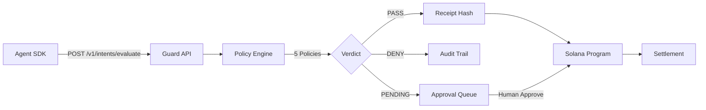
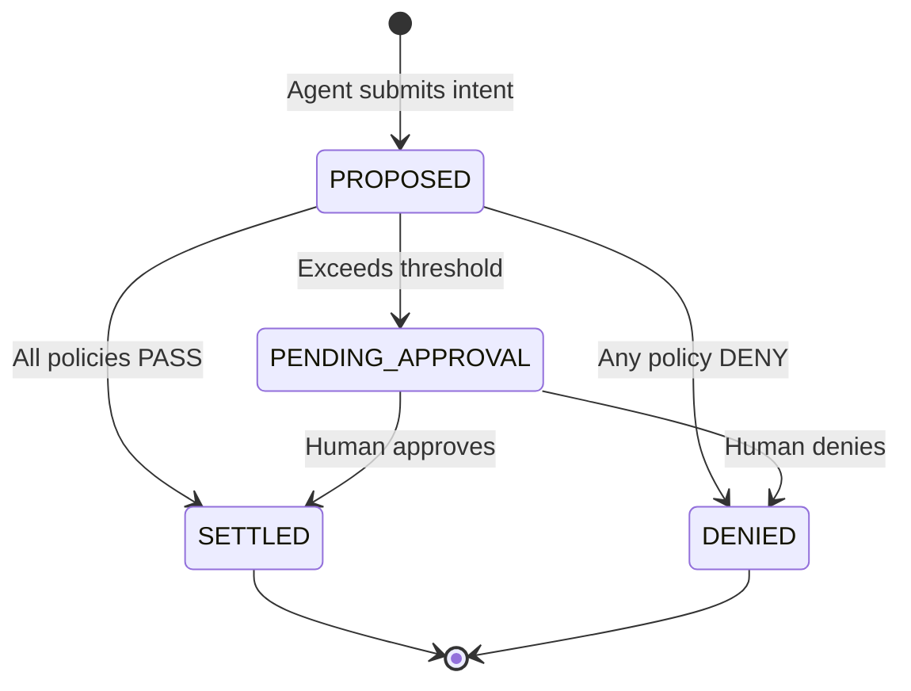

# Architecture

AgentChain Guard implements a **policy-bound settlement** model. Every value-moving action by an autonomous agent must pass through the Guard API before funds are released on-chain.

## System Overview

## Components

### Guard API (NestJS — Port 4337)

The HTTP gateway that agents interact with. Handles:
- Intent evaluation via the policy engine
- Receipt generation and storage
- Approval queue management
- Guard configuration exposure

### Policy Engine

Five configurable policies evaluated per intent:

| Policy | Purpose | Default |
|---|---|---|
| `max-spend` | Single-action spend limit | 100 USDC |
| `allowlist` | Recipient validation | Open (demo) |
| `budget-bucket` | Daily agent spend cap | 500 USDC |
| `duplicate-prevention` | Idempotency guard | Active |
| `approval-threshold` | Human sign-off threshold | >100 USDC |

### Solana Program (Anchor)

On-chain state machine managing:
- `GuardConfig` — Singleton configuration PDA
- `BudgetAccount` — Per-agent daily spend tracking
- `ActionIntent` — Individual intent lifecycle PDAs
- Token vault — SPL token escrow for settlements

### Receipt System

Every policy evaluation produces a **cryptographic receipt** — a SHA-256 hash of the full policy result JSON. The on-chain program stores only the 32-byte hash; the Guard API provides the full receipt for audit and verification.

## Intent Lifecycle

## Data Flow

1. **Agent** submits intent via `POST /v1/intents/evaluate`
2. **Policy Engine** evaluates 5 policies → aggregates worst-case verdict
3. **Receipt Service** creates SHA-256 hash of policy result JSON
4. **SQLite** stores intent + receipt for query/audit
5. **Solana Program** (optional) creates on-chain PDA with receipt hash
6. **Settlement** transfers tokens from vault to recipient
